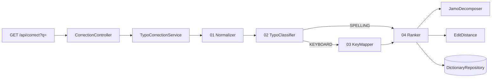

# hangul-typo-fix

> 네이버 검색의 오타 교정 기능이 **어떤 방식으로 작동하는지 분석**하고,
> 분석에서 끝내지 않고 **핵심 원리를 직접 구현해 검증**한 Spring Boot 프로젝트입니다.


| 입력 | 오타 유형 | 교정 결과 |
| --- | --- | --- |
| `dkdlvoem` | 한/영 전환 실수 (자판 오타) | **아이패드** |
| `아잇패드` | 받침 하나가 더 들어간 철자 오타 | **아이패드** (자모 거리 1) |
| `rkfortl` | 자판 오타 + 철자 오타가 겹친 경우 | `가랙시` → **갤럭시** |

<br>

## 목차

1. [프로젝트 배경](#1-프로젝트-배경)
2. [분석: 네이버 검색 오타 교정의 추정 작동 방식](#2-분석-네이버-검색-오타-교정의-추정-작동-방식)
3. [구현: 두 가지 데모](#3-구현-두-가지-데모)
4. [왜 한글 특화인가](#4-왜-한글-특화인가)
5. [아키텍처](#5-아키텍처)
6. [핵심 구현 상세](#6-핵심-구현-상세)
7. [API 명세](#7-api-명세)
8. [실행 방법](#8-실행-방법)
9. [테스트](#9-테스트)
10. [프로젝트 구조](#10-프로젝트-구조)
11. [한계와 개선 계획](#11-한계와-개선-계획)

<br>

## 1. 프로젝트 배경

검색창에 `dkdlvoem`을 입력해도 네이버는 "아이패드"로 검색할지 되묻습니다.
매일 쓰는 기능이지만, 내부에서 어떤 과정을 거치는지는 공개되어 있지 않습니다.

이 프로젝트는 다음 두 단계로 진행했습니다.

1. **분석**: AI를 활용해 검색 오타 교정의 일반적인 원리를 조사하고, 네이버 검색 기능의 작동 방식을 5단계 파이프라인으로 추정했습니다.
2. **검증**: 추정한 파이프라인 중 핵심인 *자판 매핑*과 *편집거리* 교정을 외부 한글 라이브러리 없이 직접 구현해, 실제로 오타가 교정되는지 확인했습니다.

> ⚠️ 이 프로젝트는 공개된 동작과 일반적인 오타 교정 기법을 바탕으로 원리를 추정·재구성한 것이며, 네이버의 실제 내부 구현을 재현한 것은 아닙니다.

<br>

## 2. 분석: 네이버 검색 오타 교정의 추정 작동 방식

```
01 정규화 ─▶ 02 오타 유형 판별 ─▶ 03 유형별 교정 ─▶ 04 점수화·순위화 ─▶ 05 로그 재학습
                    ▲                                                        │
                    └──────────────────── 2, 3단계로 되돌아가 반복 ────────────┘
```

| 단계 | 추정 역할 | 이 프로젝트의 구현 |
| --- | --- | --- |
| **01 정규화** | 입력을 규칙화 | ✅ `Normalizer`: 앞뒤 공백 제거, 연속 공백 정리, 영문 소문자화 |
| **02 오타 유형 판별** | 자판·편집·띄어쓰기 오타로 분류 | ✅ `TypoClassifier`: 자판 오타(`KEYBOARD`)와 철자 오타(`SPELLING`) 분류 |
| **03 유형별 교정** | 편집거리, 자판 역매핑, 띄어쓰기 모델을 병렬 진행 | ✅ `KeyMapper`, `EditDistance` 구현 (띄어쓰기 모델은 범위 외) |
| **04 점수화·순위화** | 후보 점수가 높으면 상위 추천 | ✅ `Ranker`: 자모 편집거리 기준 상위 3개 추천 |
| **05 로그 재학습** | 사용자 선택 로그로 2·3단계를 반복 개선 | 🔜 향후 계획 |

<br>

## 3. 구현: 두 가지 데모

### Demo 1. 자판 매핑: 한/영 전환 실수 교정

한글을 입력하려다 한/영 키를 누르지 않으면, 같은 자판 위치의 영문이 입력됩니다.
두벌식 자판의 키 위치를 거꾸로 따라가면 원래 입력하려던 한글을 복원할 수 있습니다.

```
d  k  d  l  v  o  e  m
ㅇ ㅏ ㅇ ㅣ ㅍ ㅐ ㄷ ㅡ   →   아 이 패 드
```

키를 자모로 바꾸는 것만으로는 부족합니다. 흩어진 자모를 **실제 음절로 조합**해야 하기 때문에,
한글 입력기와 같은 원리의 **오토마타**를 직접 구현했습니다. ([6-1 참고](#6-1-한글-오토마타-keymapper))

### Demo 2. 편집거리: 자모 단위 철자 오타 교정

`아잇패드`처럼 한글 자체가 틀린 경우에는 사전의 단어 중 **가장 비슷한 단어**를 찾아야 합니다.
두 문자열이 얼마나 다른지를 **레벤슈타인 편집거리**(삽입·삭제·치환 횟수)로 계산하고,
이때 음절이 아닌 **자모 단위**로 비교합니다.

```
아잇패드  →  ㅇㅏㅇㅣㅅㅍㅐㄷㅡ
아이패드  →  ㅇㅏㅇㅣ ㅍㅐㄷㅡ      ㅅ 하나 삭제 → 거리 1
```

### 두 데모의 결합

자판 매핑 결과가 사전에 없는 단어여도 교정은 끝나지 않습니다.
매핑 결과가 다시 편집거리 단계로 넘어가므로, **자판 오타와 철자 오타가 겹친 입력**도 교정할 수 있습니다.

```
rkfortl  ─(자판 매핑)─▶  가랙시  ─(편집거리)─▶  갤럭시
```

<br>

## 4. 왜 한글 특화인가

두 데모는 모두 **한글의 구조에 의존**합니다. 영어 오타 교정 방식을 그대로 가져오면 동작하지 않습니다.

**① 자판 오타는 한국어 환경에서만 생깁니다**
한/영 전환 실수는 두벌식 자판과 영문 자판을 번갈아 쓰는 환경에서만 발생합니다.
게다가 자모를 음절로 조합하는 과정(받침이 다음 음절 초성으로 넘어가는 경우 등)이 필요해서, 단순한 문자 치환으로는 해결되지 않습니다.

**② 음절 단위 비교는 한글 오타를 거칠게 측정합니다**
한글 한 음절은 초성·중성·종성으로 이루어져 있습니다. 음절 단위로 비교하면 받침 하나 차이와 완전히 다른 글자가 똑같이 "1글자 다름"으로 계산됩니다.

| 비교 | 음절 단위 거리 | 자모 단위 거리 |
| --- | --- | --- |
| 아이패드 ↔ 아**잇**패드 (받침 하나 추가) | 1 | **1** |
| 아이패드 ↔ 아**쇽**패드 (글자 전체가 다름) | 1 | **3** |

자모 단위로 비교해야 "사람이 실제로 낼 법한 작은 실수"와 "전혀 다른 단어"를 구분할 수 있습니다.

<br>

## 5. 아키텍처

파이프라인의 각 단계를 **하나의 클래스로 분리**해, 분석한 단계와 코드 구조가 1:1로 대응하도록 설계했습니다.



| 클래스 | 역할 |
| --- | --- |
| `CorrectionController` | API 진입점, 빈 검색어 검증(400) |
| `TypoCorrectionService` | 파이프라인 단계를 순서대로 연결 |
| `Normalizer` | 입력 정규화 |
| `TypoClassifier` | 오타 유형 판별 (`TypoType`) |
| `KeyMapper` | 두벌식 자판 매핑 + 한글 오토마타 |
| `JamoDecomposer` | 음절을 초성·중성·종성으로 분해 |
| `EditDistance` | 레벤슈타인 편집거리 계산 |
| `Ranker` | 사전 후보 점수화·순위화 |
| `DictionaryRepository` | 서버 시작 시 사전 파일을 메모리에 로딩 |

**설계 포인트**
- 단계별 클래스를 Spring Bean으로 분리하고 생성자 주입으로 연결해, 각 단계를 **독립적으로 단위 테스트**할 수 있게 했습니다.
- 새로운 오타 유형(예: 띄어쓰기)을 추가할 때 기존 클래스를 고치지 않고 단계만 추가하면 됩니다.

<br>

## 6. 핵심 구현 상세

### 6-1. 한글 오토마타 (`KeyMapper`)

영문 키를 자모로 바꾼 뒤, 자모 배열을 앞에서부터 읽으며 음절을 조합합니다.

| 처리해야 하는 경우 | 예시 |
| --- | --- |
| 기본 조합 (초성 + 중성 + 종성) | `dkd` → 앙 |
| **받침이 다음 음절 초성으로 이동** | `dkdl` → 앙ㅣ ✗ / **아이** ✓ |
| 이중모음 | `rhk` → 과, `dml` → 의 |
| 겹받침 | ㄱ + ㅅ → ㄳ |
| 겹받침 중 뒤 자음만 다음 음절로 이동 | ㄹ + ㄱ + ㅏ → 받침 ㄹ, 다음 초성 ㄱ |

가장 까다로운 부분은 **"이 자음이 앞 음절의 받침인가, 다음 음절의 초성인가"** 를 결정하는 것입니다.
자음 바로 뒤에 모음이 오면 다음 음절의 초성으로, 그렇지 않으면 받침으로 판단하도록 다음 글자를 미리 확인(lookahead)합니다.

음절은 유니코드 공식으로 직접 조합합니다.

```
음절 = 0xAC00 + (초성 인덱스 × 21 + 중성 인덱스) × 28 + 종성 인덱스
```

### 6-2. 자모 분해 (`JamoDecomposer`)

조합 공식을 거꾸로 계산해 음절을 분해합니다. 외부 라이브러리 없이 구현했습니다.

```
index = 음절 코드 - 0xAC00
초성 = index / 588        (588 = 21 × 28)
중성 = (index % 588) / 28
종성 = index % 28          (0이면 받침 없음)
```

### 6-3. 편집거리 (`EditDistance`)

레벤슈타인 거리를 동적 계획법(DP)으로 계산합니다.
2차원 표 전체를 만드는 대신 **이전 행과 현재 행, 1차원 배열 두 개만 번갈아 사용**해 공간 복잡도를 `O(n×m)`에서 `O(m)`으로 줄였습니다.

### 6-4. 후보 순위화 (`Ranker`)

1. 입력과 사전 단어를 모두 자모로 분해해 편집거리를 계산합니다.
2. **입력 길이에 비례한 허용 거리**를 넘는 후보는 제외합니다.
   짧은 단어에 큰 거리를 허용하면 엉뚱한 단어가 추천되기 때문입니다.
   ```
   허용 거리 = max(2, min(3, (자모 길이 + 1) / 2))
   ```
3. 거리가 작은 순, 같으면 가나다순으로 정렬해 **상위 3개**를 반환합니다.

<br>

## 7. API 명세

### `GET /api/correct`

| 파라미터 | 타입 | 필수 | 설명 |
| --- | --- | --- | --- |
| `q` | String | O | 교정할 검색어 |

**요청 예시**

```
http://localhost:8080/api/correct?q=dkdlvoem
```

**응답 예시 (200 OK)**

```json
{
  "input": "dkdlvoem",
  "type": "KEYBOARD",
  "mapped": "아이패드",
  "candidates": [
    { "word": "아이패드", "distance": 0 }
  ]
}
```

| 필드 | 설명 |
| --- | --- |
| `input` | 사용자가 입력한 원본 검색어 |
| `type` | 오타 유형 (`KEYBOARD`: 자판 오타, `SPELLING`: 철자 오타) |
| `mapped` | 자판 매핑 결과 (철자 오타라면 정규화된 입력) |
| `candidates` | 교정 후보 목록, 최대 3개 (`word`: 후보 단어, `distance`: 자모 편집거리) |

**예외**

| 상황 | 응답 |
| --- | --- |
| `q`가 없거나 공백만 있는 경우 | `400 Bad Request` |

<br>

## 8. 실행 방법

**요구 사항**: Java 17

```bash
git clone https://github.com/ofjrv/hangul-typo-fix.git
cd hangul-typo-fix

./gradlew bootRun        # macOS / Linux
gradlew.bat bootRun      # Windows
```

| 확인할 것 | 주소 |
| --- | --- |
| 데모 화면 | http://localhost:8080 |
| Demo 1 (자판 매핑) | http://localhost:8080/api/correct?q=dkdlvoem |
| Demo 2 (편집거리) | http://localhost:8080/api/correct?q=아잇패드 |
| 예외 처리 (400) | http://localhost:8080/api/correct?q= |

<br>

## 9. 테스트

```bash
./gradlew test
```

JUnit 5로 **단위 테스트와 API 통합 테스트 총 11개**를 작성했습니다.

| 대상 | 검증 내용 |
| --- | --- |
| `KeyMapper` | `dkdlvoem` → 아이패드, 쌍자음(까)·이중모음(과, 의) 조합, 받침의 다음 음절 이동(`dkdl` → 아이) |
| `JamoDecomposer` | 아이패드 → ㅇㅏㅇㅣㅍㅐㄷㅡ, 이중모음 분해, 단독 자모 유지 |
| `EditDistance` | 아잇패드 ↔ 아이패드 자모 거리 1, 삽입·삭제·치환, 빈 문자열 |
| `TypoCorrectionService` | 자판 오타 교정, 철자 오타 교정, `rkfortl` 입력 시 갤럭시 후보 포함 |
| `CorrectionController` | API 정상 응답(200), 빈 검색어 거부(400) |

<br>

## 10. 프로젝트 구조

```
hangul-typo-fix
├── src/main/java/com/ofjrv/hangultypofix
│   ├── CorrectionController.java     # API 진입점
│   ├── TypoCorrectionService.java    # 파이프라인 연결
│   ├── Normalizer.java               # 01 정규화
│   ├── TypoClassifier.java           # 02 오타 유형 판별
│   ├── TypoType.java
│   ├── KeyMapper.java                # 03 자판 매핑 + 한글 오토마타
│   ├── JamoDecomposer.java           # 자모 분해
│   ├── EditDistance.java             # 레벤슈타인 편집거리
│   ├── Ranker.java                   # 04 점수화·순위화
│   ├── DictionaryRepository.java     # 사전 로딩
│   ├── CorrectionResponse.java
│   └── CorrectionCandidate.java
├── src/main/resources
│   ├── dictionary.txt                # 후보 사전 (IT 기기 단어 53개)
│   └── static/index.html             # 데모 화면
└── src/test/java/...                 # 단위·통합 테스트
```

**기술 스택**: Java 17 · Spring Boot 3.4 · Gradle · JUnit 5

<br>

## 11. 한계와 개선 계획

### 현재 한계

- **사전 기반 교정**: 편집거리 교정은 `dictionary.txt`에 있는 단어(현재 IT 기기 53개) 안에서만 후보를 찾습니다. 자판 매핑은 사전과 상관없이 모든 입력에 동작합니다.
- **Shift 키 입력 손실**: 정규화 단계에서 영문을 소문자로 바꾸기 때문에, Shift로 입력하는 쌍자음·모음(`T` → ㅆ, `P` → ㅖ 등)이 기본 자모로 바뀝니다. 편집거리 단계에서 일부 보정되지만 완전하지는 않습니다.
- **띄어쓰기 오타 미지원**: 분석한 파이프라인의 띄어쓰기 모델은 이번 구현 범위에서 제외했습니다.
- **거리 기반 점수만 사용**: 실제 검색 서비스는 검색 빈도나 클릭 로그 등을 함께 반영하지만, 이 프로젝트는 편집거리만으로 순위를 매깁니다.

### 개선 계획

| 단계 | 내용 | 기대 효과 |
| --- | --- | --- |
| 1 | 자판 오타 판별 후에만 소문자화하도록 정규화 순서 조정 | Shift 쌍자음·모음 보존 |
| 2 | 국립국어원 표준국어대사전 단어 목록으로 사전 확장 | 교정 가능한 단어 범위 확대 |
| 3 | **BK-Tree** 도입 | 사전이 수십만 개로 커져도 전체 비교 없이 빠르게 후보 탐색 |
| 4 | 교정 결과 선택 로그 수집 후 검색 빈도 가중치 반영 | 파이프라인 05단계(로그 재학습) 구현 |
